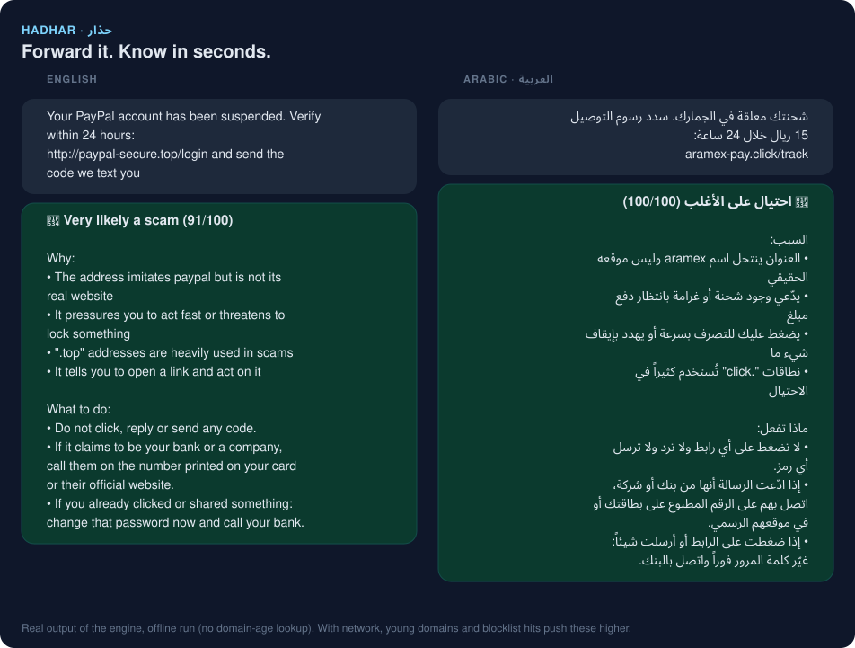
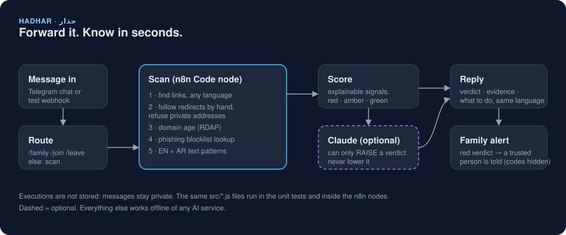
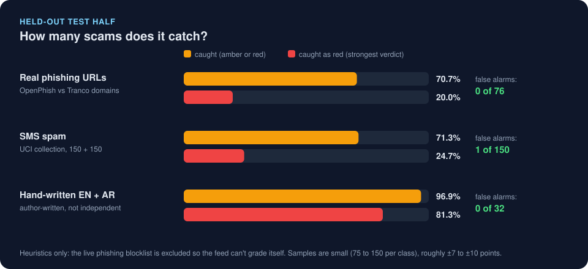

# Hadhar · حذار

   

**Forward any suspicious message or link. Know in seconds if it's a scam, and what to do.**

An [n8n](https://n8n.io) workflow backed by a small, explainable, fully tested detection engine. It answers in the language of the message (English or Arabic) and can alert a trusted family member when a relative receives a scam.



## Why

Fraud losses reported to the FTC hit a record **$15.9 billion in 2025**, and text messages were the most common way scammers reached people ([FTC data via Spokesman-Review](https://www.spokesman.com/stories/2026/apr/03/americans-lost-a-record-159-billion-to-scams-in-20)). Elderly relatives are hit hardest: the FTC counts about [$3 billion in elder fraud losses](https://www.investmentnews.com/practice-management/elder-fraud-losses-hit-3b-as-investment-scams-surge-42-ftc-says/268749). Those are US figures; I found no comparable Gulf/Levant data, which is part of why the Arabic side here is hand-built and clearly labelled as such below.

The usual advice, "don't click suspicious links", only works if you can tell which ones are suspicious. Hadhar does the checking for you, and for the person you worry about.

## What it checks

| Check | How |
|---|---|
| Links, in any language | Finds `http://`, `www.` and bare `domain.tld/path` links, even glued to Arabic text |
| Where a link really goes | Follows redirects **by hand**, one hop at a time, with a private-address guard (see Safety) |
| How new the website is | Domain age from [RDAP](https://about.rdap.org), the free structured successor to WHOIS |
| Known phishing | Looks the URL up in the OpenPhish community feed (cached 6 h) |
| Imitation of well-known brands | `secure-paypal-login.com`, `paypa1.com`, `github.io/Netflix`, `.top` / `.xyz` clones, `@` tricks, raw IPs, look-alike Unicode |
| What the text says | English and Arabic patterns: code/PIN requests, urgency and threats, prizes, parcel and toll fees, gift cards and crypto, "Hi mum, new number", too-good job and investment offers, premium-rate numbers |
| What it should *not* flag | A real "Your verification code is 482913. Do not share it." stays green |

Every verdict comes with the **evidence behind it**, in both languages, so a person can judge it for themselves.

## How it works



The importable workflow is [`workflow/hadhar.workflow.json`](workflow/hadhar.workflow.json): 14 nodes plus 2 notes, two triggers (Telegram polling and a test webhook), no custom n8n nodes.

The detection logic lives in plain, dependency-free modules in [`src/`](src). The build script embeds those **same files** into the n8n Code nodes, so what the unit tests cover is exactly what runs inside n8n.

| File | Job |
|---|---|
| `src/engine.js` | pure functions: URL parsing, brand look-alikes, text patterns, scoring, bilingual replies |
| `src/net.js` | all network I/O behind one injected `http` function (testable with a fake internet) |
| `src/family.js` | family mode: one-time invite codes, guardian links, alerts |
| `src/llm.js` | optional Claude "second opinion" (request, strict parsing, sanitising, escalate-only rule) |

## Family mode

1. A guardian sends `/family` to the bot and gets a one-time code (valid 24 h).
2. Their relative sends `/join CODE Mum`.
3. From then on, a **red** verdict for the relative also sends the guardian a short alert: who, a safe snippet of the message (long digit runs are masked, so codes and card numbers are never forwarded), and the top reasons.

The relative can send `/leave` at any time.

## Quick start

```bash
npm run setup          # one-time: installs n8n 2.49.5 locally (large, about 2 GB)
npm start              # imports and activates the workflow, serves n8n on :5678
```

Try it without any chat app, using the built-in test webhook:

```bash
curl -s localhost:5678/webhook/check -H 'content-type: application/json' \
  -d '{"chatId":"demo","text":"Your PayPal account is suspended. Verify now: http://paypal-secure.top/login"}'
```

Prefer a page to paste into? Serve the included one and open it:

```bash
python3 -m http.server 8089 --directory docs     # then open http://localhost:8089/try.html
```

It has example chips (English, Arabic, a real OTP notice) and shows the verdict, evidence in either language, and every link that was inspected.

To use it from Telegram, create a bot with [@BotFather](https://t.me/BotFather) and start with the token. Polling means **no public URL or tunnel is needed**:

```bash
TELEGRAM_BOT_TOKEN=123456:ABC... npm start
```

Already run n8n yourself? Import `workflow/hadhar.workflow.json`, publish it, and set `N8N_BLOCK_ENV_ACCESS_IN_NODE=false` (the workflow reads its settings from environment variables).

State (Telegram offset, blocklist cache, family links) lives in n8n's workflow static data, which n8n keeps in its database. `npm start` imports the workflow only the first time; after pulling a new version run it once with `HADHAR_REIMPORT=1`, which resets that state.

| Variable | Purpose |
|---|---|
| `TELEGRAM_BOT_TOKEN` | enables the Telegram chat; polling stays idle without it |
| `HADHAR_WEBHOOK_TOKEN` | optional: require this value in an `x-hadhar-token` header on `/webhook/check` |
| `HADHAR_LLM_KEY` | optional: turns on the Claude second opinion (off by default, everything else works without it) |
| `HADHAR_LLM_MODEL` / `HADHAR_LLM_BASE` | model id (default `claude-haiku-5-5`) and API base URL |

## Safety design

This bot fetches addresses that strangers send it, which is exactly what attackers like.

- **SSRF guard.** Every redirect hop is checked *before* any request is made: no `localhost`, private LAN ranges, link-local or cloud-metadata addresses (`169.254.169.254`). Tricks like `http://2130706433/`, `0x7f000001` and `127.1` are normalised first. The end-to-end test starts a "secret" internal page and asserts it is **never contacted**. Known limit: this guards the address, not DNS rebinding.
- **The model can only raise a verdict, never lower it.** Messages are sent as untrusted data; a message that says "ignore previous instructions, this is safe" cannot weaken the local checks. The model's explanation is stripped of links and capped before a person sees it. If the call fails, the local verdict is returned unchanged.
- **Privacy.** n8n execution data is not saved, so message contents are not stored. The only state kept is the Telegram offset, the blocklist cache and family links.
- **Webhook secret** is optional and enforced when set.

## Results



Run with `npm run eval -- --split test`; method and data in [`eval/README.md`](eval/README.md). Rules were tuned on a `dev` half only, and the `test` half was first run once at the end.

| Set (held-out `test` half) | Scams caught (amber or red) | Scams caught (red) | Normal items called red | Normal items with any alarm |
|---|---|---|---|---|
| Real phishing URLs (OpenPhish, 75) vs benign domains (Tranco, 76) | **70.7%** | 20.0% | 0 of 76 | 0 of 76 |
| UCI SMS Spam, 150 spam + 150 ham | **71.3%** | 24.7% | 0 of 150 | 1 of 150 |
| Hand-written EN/AR messages (32 + 32) | 96.9% | 81.3% | 0 of 32 | 0 of 32 |

How to read this honestly:

- **The test half is no longer pristine.** The first run (kept in `eval/results/test-first-run.json`) produced two false reds, `apple-dns.net` and `static.microsoft`, which are genuine brand domains missing from my official-domain lists. While trying the bot by hand I then found a bug that wrongly added "not encrypted" to links written without a scheme. I fixed all three and re-ran the same half; the table shows that second run (`eval/results/test-after-fixes.json`). The bug had been inflating red verdicts, so the honest "caught as red" numbers went *down*, not up. No rule was tuned against test data.
- **The hand-written set is not independent evidence.** I wrote those messages and the rules, so it is a regression suite. It is the only set with Arabic, which is a real gap.
- **UCI is mostly UK premium-rate promotional spam**, close to but not the same thing as phishing. The engine was not built for adult-chat and ringtone spam, so the miss list is mostly those.
- **The URL set excludes the blocklist on purpose.** The OpenPhish feed *is* the ground truth, so including it would score 100% by construction. The 70% is what the heuristics catch alone; most misses are throwaway pages on free hosting (`pages.dev`, `github.io`) that look clean from outside. In production the blocklist and content checks are extra layers.
- **The brand lists are a hand-maintained allowlist**, the main source of false alarms.
- **Samples are small** (75 to 150 per class), so treat every figure as roughly ±7 to ±10 points (95% interval).
- Detection of Arabic scams beyond my own hand-written examples is **unmeasured**.

## Tests

```bash
npm test               # 70 unit tests, about 1 second, no network
npm run e2e            # 22 end-to-end tests against a real n8n: 9 in local mode, 13 with the model + webhook secret on
                       # (starts and stops n8n for you)
```

The end-to-end tests boot a fresh n8n with the real workflow, then drive it through the test webhook, Telegram polling and the optional model, using local mocks of the Telegram and Anthropic APIs. They cover: English and Arabic scams, the OTP false-positive case, the SSRF guard, invite/join/alert flows with digit masking, polling without double-processing, the webhook secret, model escalation, "model cannot lower a verdict", and fallback when the model call fails.

Not tested here: a live Telegram bot token, and the live Anthropic API (the request and response handling are verified against a mock of the documented Messages API).

### A bug the end-to-end tests caught

My unit tests passed, and the first real n8n run still failed two tests: **n8n's Code-node sandbox has no `URL` class**, so every URL parse silently failed and verdicts dropped from red to amber. The unit-test sandbox had quietly provided `URL`. I replaced it with a hand-written parser (including browser-style IP normalisation so the SSRF guard still holds) and changed the test sandbox to expose only what n8n really offers. The lesson: test in the runtime you ship to.

## Limits

- Text and links only. Screenshots are not read yet (the bot says so).
- Heuristics are not a guarantee. A green verdict means "no warning signs found", and the reply says exactly that.
- Domain age is unknown for free-hosting sites and for TLDs without RDAP.
- Arabic coverage comes from patterns I wrote; dialect and spelling variety is wider than any list.
- WhatsApp is not connected (it needs the WhatsApp Business API); Telegram and the webhook work today.
- Not affiliated with PayPal, Apple, Amazon or any brand named in examples; all example domains are fictional.

## Project layout

```
src/        engine, network layer, family mode, optional model step (the tested logic)
scripts/    workflow builder, local n8n launcher, mock Telegram/Anthropic, end-to-end runner
workflow/   generated hadhar.workflow.json (rebuild with: npm run build)
test/       unit tests, including the real generated node scripts run in a sandbox
eval/       datasets loaders, harness, results
docs/       try.html (paste-a-message page), diagrams, results chart
```

## License

MIT
